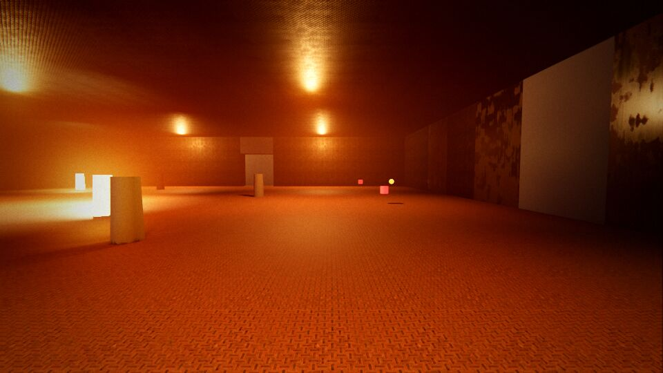
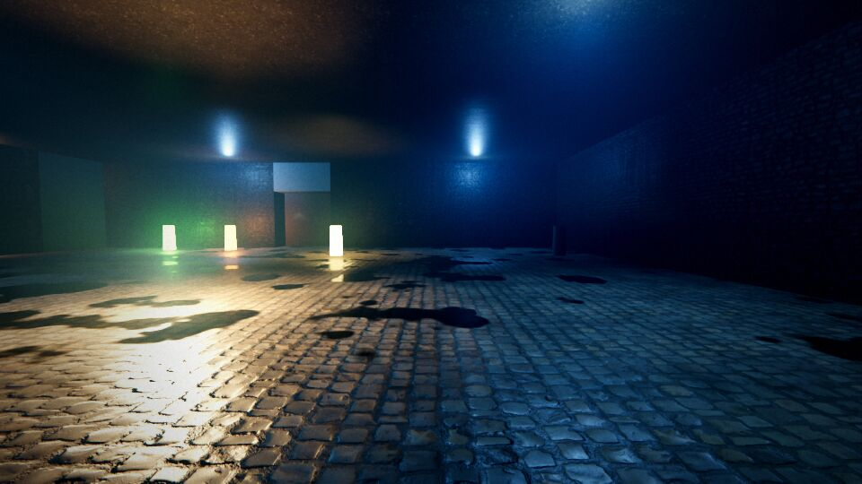
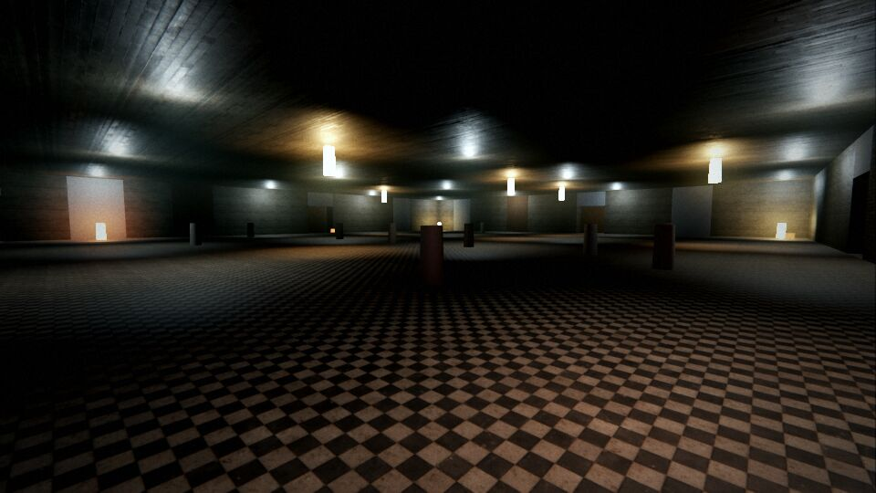
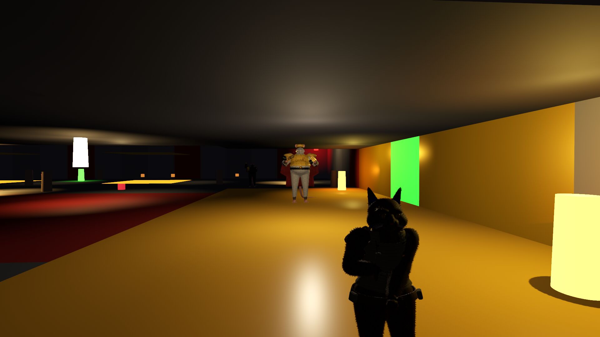
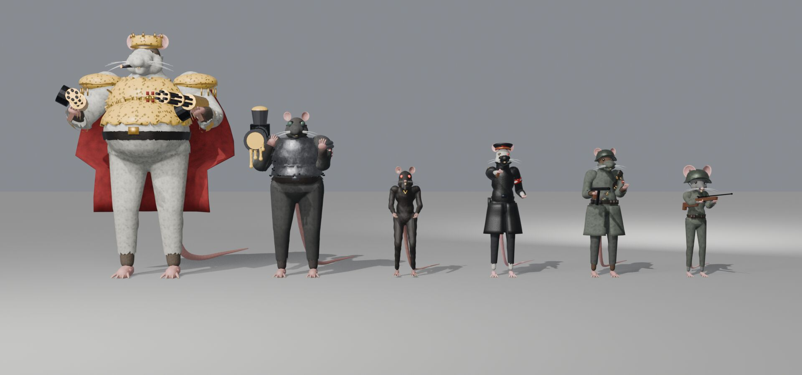
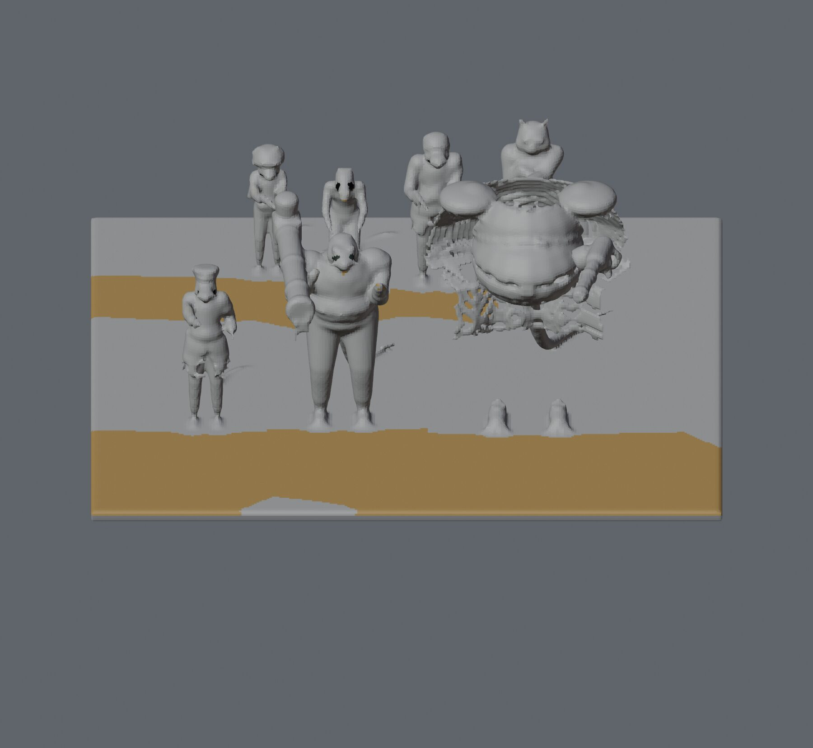

# KÄSEKRIEG: RAT OPS (Call of Cheese Duty)

**A third-person cat-versus-rat tactical shooter, built in Godot 4.7 by a swarm of AI agents.**
Major Marmalade, a very large orange tabby with nine lives, fights through six levels of Das Rattenreich:
rats and mice in WWII-style uniforms, guarding cheese. Every model, shader, sound effect, music track and level
in the repo is generated from text (Blender scripts, GDScript, Python audio synthesis, level JSON).

[](https://godotengine.org)
[](LICENSE)
[](https://github.com/bsommers/callofcheeseduty-ratops/releases)
[](https://github.com/bsommers/callofcheeseduty-ratops/releases)
[](https://bsommers.github.io/callofcheeseduty-ratops/)

**[Download](https://github.com/bsommers/callofcheeseduty-ratops/releases)** ·
**[Project site](https://bsommers.github.io/callofcheeseduty-ratops/)** ·
**[How it was made](docs/HOW-IT-WAS-MADE.md)** ·
**[Docs index](docs/INDEX.md)**



| | |
|---|---|
|  |  |
|  |  |

> These are real captures from the Godot renderer (960x540, Vulkan) and Blender previews, taken during development.
> The game is a work in progress and an honest 0.1.0: see [Known issues](docs/RELEASE-NOTES.md#known-issues).

## Features

- **Six levels** (`e1m1` to `e1m6`) with keys, locked doors, pushwalls (secrets), treasure, an exit switch and a boss. Layouts are ported from the 2.5D predecessor [KÄSEKRIEG: Claws of Marmalade](https://github.com/bsommers/kasekrieg). See [Levels and enemies](docs/LEVELS-AND-ENEMIES.md).
- **Third-person gunplay** in the CS:GO mould: over-the-shoulder camera with shoulder swap, hold-to-aim, recoil spray patterns, accuracy penalty while moving, crouch, reload, headshots (2.5x), bullet decals, muzzle-flash lights.
- **Five weapon slots plus claws**: Hairball Pistol, Purr-forator (automatic), Yarn Bomber (bouncing grenades), Der Rote Punkt (laser beam).
- **Six enemy kinds** with a state-machine AI (patrol, alert, chase, attack, take cover, retreat), sight cones, hearing via noise events, and a two-phase boss, Der Große Käse (1100 HP).
- **Four skill levels**: Kitten, House Cat, Alley Cat, Nine Lives Nightmare.
- **Procedural everything**: models authored by Blender Python scripts, exported as glTF; shell-texture **fur shader** on the cat and rats; a signature **cheese shader** (3D Worley holes, waxy rind, subsurface glow); wet-surface, cloth, glass and gold-foil shaders.
- **Look rig**: per-level data-driven lighting (SDFGI, SSR, SSAO, volumetric fog, ACES tonemap, grain, vignette) with Low / Medium / High / Ultra quality tiers.
- **Synthesised audio**: 79 sound effects, ambience loops and techno-metal music layers, all generated by a deterministic numpy script ([tools/gen_audio.py](tools/gen_audio.py)).
- **Headless QA bot** that plays whole levels, and 60+ headless logic tests.
- **3D-printable models**: OBJ and STL files for the hero, rats, weapons, props and level dioramas. See [PRINTING.md](docs/PRINTING.md).
- **Native builds** for Linux, Windows and macOS (unsigned).

## Install

Download assets from [GitHub Releases](https://github.com/bsommers/callofcheeseduty-ratops/releases). Builds are
unsigned and un-notarised, so your OS will warn you. Each is about 190 MB. Verify with `SHA256SUMS`.

| OS | Asset | How |
|---|---|---|
| Linux x86_64 | `kasekrieg-ratops-<ver>-linux-x86_64.tar.gz` | `tar xzf ...` and run the launcher inside |
| | `kasekrieg-ratops_<ver>_amd64.deb` | `sudo dpkg -i ...` |
| | `kasekrieg-ratops-<ver>-linux-x86_64-install.sh` | `sh ...-install.sh` (per user) |
| Windows 10/11 x64 | `KasekriegRatOps-windows-x64-setup.zip` | unzip, run `install.cmd` (per user, no admin). SmartScreen: More info, Run anyway |
| macOS 12+ (universal) | `KasekriegRatOps-macos.dmg` | copy the app to Applications, then `xattr -dr com.apple.quarantine "/Applications/KÄSEKRIEG- RAT OPS.app"` or right-click, Open |

Requirements: a Vulkan 1.2 GPU (Linux), Vulkan or D3D12 (Windows), Metal (macOS); about 1 GB disk, 4 GB RAM (8 GB on macOS).
Full notes and known issues: [docs/RELEASE-NOTES.md](docs/RELEASE-NOTES.md).

## Controls

| Action | Keyboard / mouse | Gamepad |
|---|---|---|
| Move / look | WASD or arrows / mouse | left / right stick |
| Fire / Aim | LMB / RMB | triggers |
| Reload / Use | R / E | face buttons |
| Jump / Crouch / Sprint | Space / C or Ctrl / Shift | buttons |
| Weapons | 1 to 5, mouse wheel | bumpers |
| Swap shoulder | Q | stick click |
| Map / Pause | M or Tab / Esc or P | Start |

Everything is rebindable in Settings. Details: [docs/CONTROLS.md](docs/CONTROLS.md).

## Run from source

Requirements: Godot 4.7.x (the Forward+ renderer needs Vulkan). Blender 5.3 and Node.js are only needed for the tooling.

```sh
git clone https://github.com/bsommers/callofcheeseduty-ratops
cd callofcheeseduty-ratops

# Open game/ in the Godot editor and press F5, or from a shell with godot on PATH:
godot --path game                          # title screen
godot --path game -- --level=e1m1          # skip the title, start a level
```

`tools/godot.sh` is a wrapper that runs a project-local Godot binary from `.tools/` (not in git; edit it to point at your own install).
All models, textures, HDRIs and audio are committed, so a clone runs as-is. Textures and HDRIs are CC0 downloads recorded in [docs/ASSETS.md](docs/ASSETS.md) (re-fetch with `node tools/fetch_assets.mjs`).

```sh
tools/run_tests.sh                 # headless logic tests (game/tests/test_*.gd)
tools/qa.sh all --god              # QA bot plays every level headless, prints a table
tools/shot.sh e1m1 out/e1m1.png    # one real GPU frame without opening a window
```

## Build

```sh
tools/build.sh linux|windows|macos|all     # export presets in game/export_presets.cfg
tools/package_linux.sh                     # .tar.gz, .deb, self-extracting installer
tools/package_windows.sh                   # setup zip with install.cmd / install.ps1
tools/package_macos.sh                     # needs MAC_HOST=user@host (builds the dmg on a Mac)
```

Export templates for Godot 4.7.2 are required. Walkthroughs: [BUILD.md](docs/BUILD.md), [BUILD-WINDOWS.md](docs/BUILD-WINDOWS.md), [BUILD-MACOS.md](docs/BUILD-MACOS.md).

## 3D-print models

`blender -b -P tools/blender/print_export.py -- build` and `node tools/print_levels.mjs` generate watertight OBJ/STL files
in millimetres: the hero at 75 mm tall, all six rats, weapons and props at 1:35, a squad plate, and the level dioramas
(including a four-tile castle of the boss level). Scales, wall thicknesses and print advice: [docs/PRINTING.md](docs/PRINTING.md).



## Project layout

| Path | What is in it |
|---|---|
| `game/` | The Godot project (`project.godot`, `res://`) |
| `game/autoload/` | `Defs` (weapon/enemy/item/scoring tables), `Events` (signal bus), `Game` (state, level flow), `Settings` |
| `game/scripts/` | `player/`, `enemy/`, `level/`, `weapons/`, `ui/`, `audio/`, `look/`, `integration/` (wiring), `qa/` (bot) |
| `game/data/` | `levels/*.json`, `enemies.json`, `weapons.json`, `look/*.json`, `material_map.json` |
| `game/assets/` | models (glTF), textures and HDRIs (CC0), shaders, material library, synthesised audio |
| `game/tests/` | Headless logic tests |
| `tools/` | `godot.sh`, `build.sh`, `package_*.sh`, `qa.sh`, `shot.sh`, `blender/` model scripts, `gen_audio.py`, `swarm-tracker/` |
| `docs/` | This documentation; `docs/swarm/` holds the swarm manifest and the per-agent reports |
| `ARCHITECTURE.md` | The contract the agents built against |

## Documentation

[Docs index](docs/INDEX.md) · [Architecture overview](docs/ARCHITECTURE.md) · [How it was made](docs/HOW-IT-WAS-MADE.md) ·
[Levels and enemies](docs/LEVELS-AND-ENEMIES.md) · [Controls](docs/CONTROLS.md) · [Contributing](docs/CONTRIBUTING.md) ·
[Assets and licences](docs/ASSETS.md) · [Swarm manifest](docs/swarm/SWARM.md) · [Learnings](docs/swarm/LEARNINGS.md)

The reusable parts of the pipeline (swarm tracker, print export, packaging scripts) are being collected in
[game-factory](https://github.com/bsommers/game-factory).

## Licence

Code and original assets: [Apache-2.0](LICENSE). Third-party textures and HDRIs are CC0 (Poly Haven, ambientCG) and listed in
[docs/ASSETS.md](docs/ASSETS.md); Godot is MIT. The enemy emblem is a cheese wedge on red; there are no real-world hate symbols in the game.
"Call of Cheese Duty" is a parody name; there is no affiliation with any commercial game.
