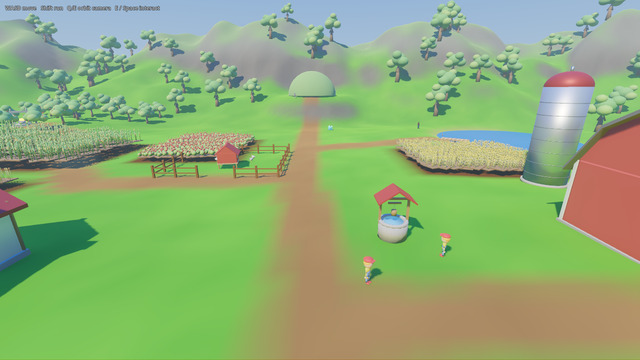
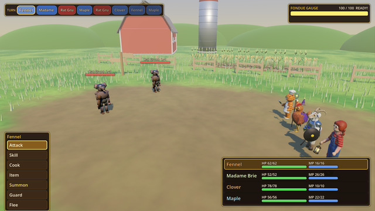
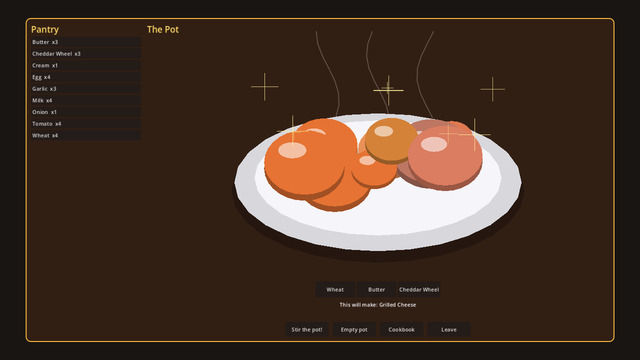
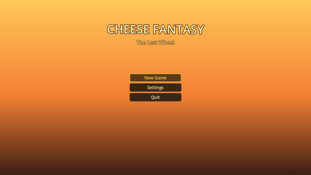

# CHEESE FANTASY: The Last Wheel

Turn-based cheese JRPG (Final Fantasy / Pokemon feel) on Curdlewick Farm in the Whey Valley. The Rat King Gorgonzolo has stolen the
Last Wheel; a party of four (Fennel, Madame Brie, Clover, Maple) explores the farm, fights rats and blobs in turn-based battles,
summons spirits, and cooks cheese dishes. Godot 4.7.2, GDScript, Forward+, all characters modelled in Blender.

 
 

## Run
- From a build: `dist/` has Linux (`.tar.gz`, `.deb`, `-install.sh`), Windows (`-setup.zip`, run `install.cmd`), macOS (`.dmg`).
- From source: `tools/godot.sh --path game` (needs a display; headless check: `tools/godot.sh --headless --path game --quit`).
- Screenshots without a window: `tools/shot.sh`. Rebuild: see [docs/BUILD.md](docs/BUILD.md).

## Controls
WASD move, Shift run, Q/E rotate camera, interact / confirm / cancel / menu via the actions in Project Settings > Input Map
(defaults: E/Enter interact+confirm, Esc cancel/menu). Battles and menus are fully navigable with the confirm/cancel keys.

Design contract: [ARCHITECTURE.md](ARCHITECTURE.md).
