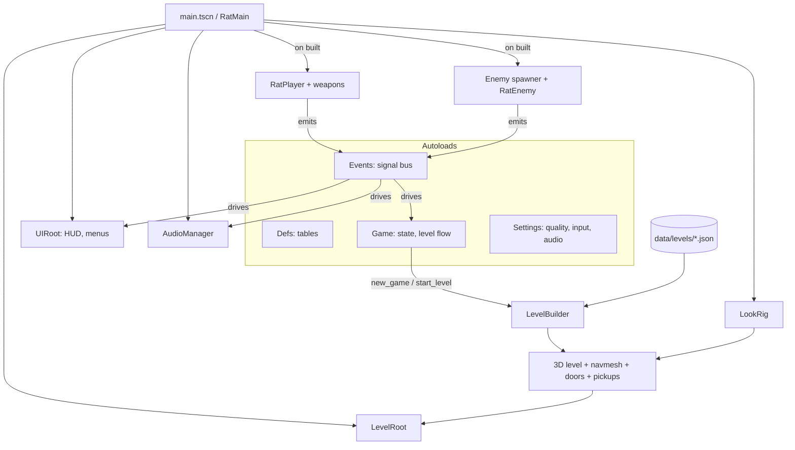
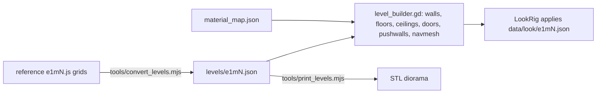

# Architecture overview

This page explains how the game is put together. The repository-root [`ARCHITECTURE.md`](../ARCHITECTURE.md) is the
shorter, binding contract the swarm agents built against (written before the code existed); where this page and the code
differ, the code wins. Per-module detail is in the [agent reports](swarm/reports/).

## Stack

| Layer | Choice |
|---|---|
| Engine | Godot 4.7.2, GDScript, Forward+ (Vulkan; Metal on macOS) |
| Models | Blender 5.3 headless scripts in [`tools/blender/`](../tools/blender) writing glTF (`.glb`) into `game/assets/models/` |
| Textures / HDRIs | CC0 only (Poly Haven, ambientCG), see [ASSETS.md](ASSETS.md) |
| Audio | Synthesised by [`tools/gen_audio.py`](../tools/gen_audio.py) (numpy, deterministic) to WAV |
| Tooling | Node.js with zero npm dependencies; shell scripts for build, package, QA |

Godot has no hardware ray tracing, so the "ray-traced look" is SDFGI, SSR, SSAO, SSIL, volumetric fog, reflection probes and
contact shadows, configured per level by the look rig.

## Runtime structure

- **Signals are the seam.** [`Events`](../game/autoload/events.gd) declares every cross-module signal (`player_hurt`, `enemy_killed`, `pickup_taken`, `weapon_changed`, `level_completed`, `noise`, ...). Modules emit and connect there instead of holding references to each other. That is what let independent agents write HUD, audio, AI and player code in parallel.
- **Data drives content.** Weapon, enemy, item and scoring tables live in `Defs` and `game/data/*.json`; levels are JSON; per-level lighting is JSON. Changing balance or a mood does not need code changes.
- **Boot flow.** [`main.gd`](../game/scripts/integration/main.gd) wires UI, audio and the level parent; on `Events.level_loaded` it waits for the builder's `built` signal, then spawns the player, applies the hero setup (fur shells, weapon attachment), props and enemies.
- **World units.** 1 level cell = 4 m, walls 3.6 m, Y up, -Z forward. Physics layers: world, player, enemy, projectile, pickup, trigger, door.

## Level pipeline

## Rendering and materials

- **Fur**: [`fur.gdshader`](../game/assets/shaders/fur.gdshader) is a shell-texture shader (8/16/24 shells by quality tier, a length mask on the hero) plus a cheaper single-pass `fur_lod` beyond 16 m.
- **Cheese**: [`cheese.gdshader`](../game/assets/shaders/cheese.gdshader) uses object-space 3D Worley noise for holes (no UVs, no seams), a cavity normal, waxy rind via vertex colour, subsurface glow and clearcoat.
- Others: `skin_sss`, `cloth`, `wet_metal`/`wet` include, `glass`, `gold_foil`, `emblem`, `triplanar_pbr`. A script builds a 65-material library, accessed through `RatMaterials`.
- **Look rig** ([`look_rig.gd`](../game/scripts/look/look_rig.gd)): merges `look/default.json` with `look/<level>.json` and builds the environment, sun, film-finish post pass ([`post_fx.gdshader`](../game/scripts/look/post_fx.gdshader): grain, vignette, chromatic aberration) and retunes the level's own lights at runtime.

## Characters

The hero (about 55k triangles, 64 bones, 19 animation clips) and six rat kinds (35-bone rig) are authored in Blender Python
([`hero.py`](../tools/blender/hero.py), [`rats.py`](../tools/blender/rats.py), [`props.py`](../tools/blender/props.py)).
Enemy AI is a `CharacterBody3D` state machine on the level navmesh; see [LEVELS-AND-ENEMIES.md](LEVELS-AND-ENEMIES.md).

## Testing

| What | How |
|---|---|
| Logic | `tools/run_tests.sh` runs `game/tests/test_*.gd` headless (defs, game state, level builder, player, enemy, audio, UI, models, look, materials, print models) |
| Whole-level playthrough | `tools/qa.sh [level\|all] [--god] [--skill=N]`: a bot built on the real player controller and its own lock-aware navmesh, fixed seed, `--fixed-fps 60` |
| Visuals | `tools/shot.sh <scene\|level> out.png`: a real GPU frame rendered inside a private Xvfb, never on your desktop |

## Build and release

[`tools/build.sh`](../tools/build.sh) drives Godot export presets ([`game/export_presets.cfg`](../game/export_presets.cfg)) for Linux x86_64,
Windows x86_64 (embedded PCK) and macOS universal. The `package_*.sh` scripts wrap outputs into a tar.gz/deb/self-extracting
installer, a setup zip, and a dmg. Textures are VRAM-compressed on export, cutting the pack from 650 MB to about 196 MB.
See [BUILD.md](BUILD.md).
