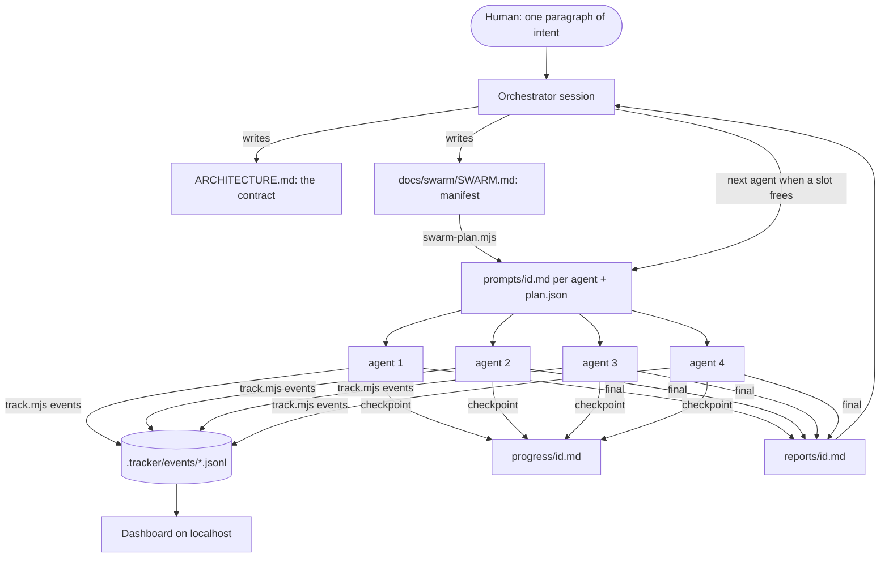
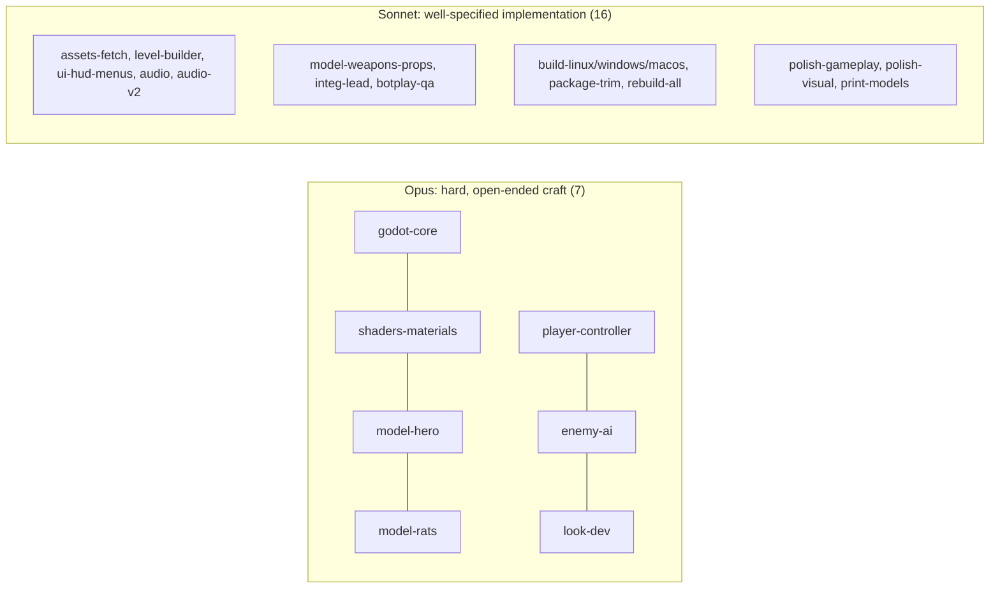
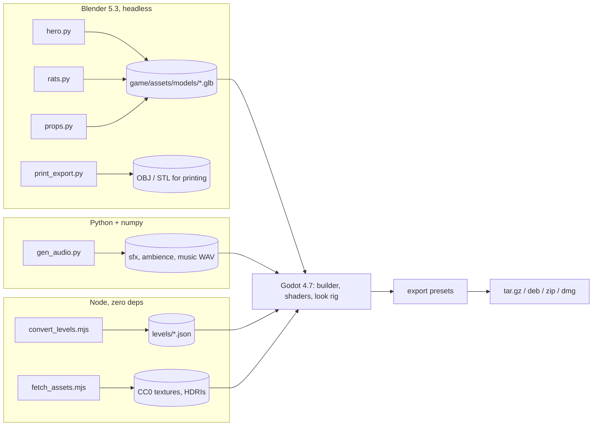
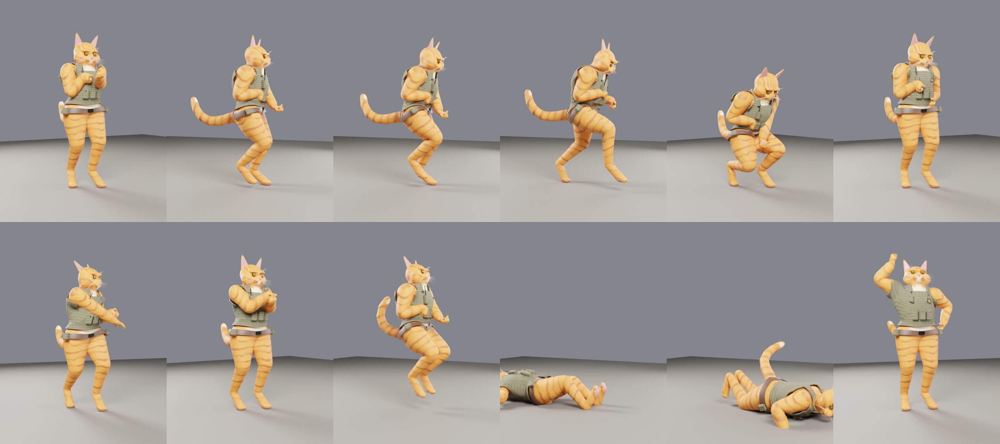

# How it was made: a game built by a swarm of AI agents

RAT OPS was built overnight by one orchestrating Claude session that spawned and supervised **23 subagents**, each owning
a slice of the repo. This page tells how the process worked, what it produced, what went wrong and what we would do again.
Everything here is checkable: the manifest is [`swarm/SWARM.md`](swarm/SWARM.md), every agent wrote a report in
[`swarm/reports/`](swarm/reports/), and the tooling is in [`tools/swarm-tracker/`](../tools/swarm-tracker). The
reusable version of that tooling lives in [game-factory](https://github.com/bsommers/game-factory).

## By the numbers

| | |
|---|---|
| Wall clock | first agent started 22:27 local on 14 Nov 2026; last commit 02:58 on 15 Nov (git history: six commits) |
| Agents | 23 in the manifest: 7 on Opus, 16 on Sonnet (no Haiku was used) |
| Phases | p1 foundation, p2 characters and gameplay, p3 integration and look, p4 build and release |
| Concurrency | never more than 4 agents at once |
| Output | about 8,000 lines of GDScript in `game/scripts`, 18 headless test files, 698 asset files under `game/assets/models`, 79 synthesised sound effects |
| Platforms | Linux, Windows (tested in a VM), macOS (tested on a real Mac) |

## The workflow

**1. The contract first.** Before any agent ran, the orchestrator wrote [`ARCHITECTURE.md`](../ARCHITECTURE.md): engine, tools,
world units, physics layers, input action names, the `Events` signal list, rendering targets, the gameplay port rules. It is
short on purpose. The key idea is that agents never talk to each other; they talk to the contract. Because modules communicate
through signals on one `Events` autoload, a HUD agent could finish a HUD before the player controller existed.

**2. The manifest.** [`SWARM.md`](swarm/SWARM.md) is the single source of truth. Each agent is one section:
`## id | model | phase | role | Name`, an `owns:` line listing the paths it may edit, and the task. A shared preamble holds the rules;
role appendices add Godot or Blender specifics. [`swarm-plan.mjs`](../tools/swarm-tracker/bin/swarm-plan.mjs) expands it into one prompt file per agent.
Ownership by path means two agents rarely edit the same file; when one needed a change in another's file, it wrote a
"Requests for other modules" line in its report and the orchestrator routed it.

**3. The prompt.** Every agent is started with one line: *read `docs/swarm/prompts/<id>.md` and execute it exactly, keep chat output minimal.*
The preamble tells it to read only what it needs (grep, offset/limit), never touch files it does not own, verify by running and looking,
report failures honestly, install no new dependencies, never open a window on the user's desktop, and use `date -u` instead of inventing timestamps.

**4. Tracking.** Agents call `track.mjs <id> start|progress|done|blocked|failed` at milestones, which append JSON lines under `.tracker/events/`.
A small zero-dependency Node dashboard ([`dashboard/server.mjs`](../tools/swarm-tracker/dashboard/server.mjs), localhost only) turns them into a live board of agents, percentages,
phases and check results. It is how the orchestrator, and the human, saw who was alive.

**5. Reports.** Each agent ends with a report with fixed sections: what I built, verification evidence, deviations from the contract,
mistakes I made and how I fixed them, learnings for a future agent, requests for other modules. The "mistakes" section turned out to be the most valuable part of the swarm.

## Model tiering

Rule of thumb that emerged: **Opus where the task is "make something that looks and feels right"** (the engine foundation, shaders, characters, controller feel, AI, lighting);
**Sonnet where the task is "do this well-described thing and verify it"** (data conversion, UI, build scripts, polish from a bug list).
A cheaper tier (Haiku) would suit mechanical edits; the manifest did not need it. A top creative tier was held back for look-dev and art direction; usage limits
and timing meant look-dev ran on Opus. The orchestrator itself ran on Sonnet.

## The four-agent cap

Early in the sibling project the session hit usage limits four times with eight or more agents running at once. The rule became:
**at most four agents concurrently**, and a new one is launched only when a slot frees. Phases were ordered so that four-at-a-time still worked:
the foundation wave (engine, assets, shaders, level builder) ran first because everything else needs it; models ran next because
the AI and integration need real skeletons; integration, look and QA ran after both.

## Checkpoint and respawn

Agents are in-process sub-sessions: if the orchestrator dies, its agents die with it, and an agent's own context fills up. Two mechanisms handled this.

- **Agent checkpoints.** After about 25 tool calls, or at any milestone with substantial work left, an agent updates `docs/swarm/progress/<id>.md`
  (30 lines max: done, next steps in order, gotchas, commands to verify) and ends its turn with a final line `CONTINUE: <next step>`. The orchestrator then spawns a fresh agent
  with the same one-line prompt; the preamble says that if a checkpoint exists, trust it and continue rather than start over.
- **Orchestrator checkpoint.** The orchestrator keeps a state file with decisions, the running set, the user's standing rules, and what is next. When the orchestrator session
  ended mid-wave once, a new one read that file, noticed the dead agents and respawned them. The state file is gitignored because it holds machine-specific detail.

Keeping each agent's context small was an explicit rule: read with offsets, pipe output through `tail`, look at no more than about six images, prefer numeric checks over screenshots.

## The procedural pipeline

No artist drew anything. Every asset has a text source.

- **Models.** `hero.py` and `rats.py` build meshes, rigs (64 and 35 bones) and animation clips from code, export glTF, and render a Blender preview PNG that the agent must look at
  before claiming done. Fur colour and length are driven by a mask texture, not by sculpting. The honest result is stylised more than photoreal; see limitations.
- **Shaders.** [`fur.gdshader`](../game/assets/shaders/fur.gdshader) stacks 8 to 24 shells with a noise-driven strand mask; [`cheese.gdshader`](../game/assets/shaders/cheese.gdshader)
  carves holes with 3D Worley noise in object space so no UVs are needed. The shader agent iterated against GPU renders: its first Swiss holes were almost invisible, its first rat fur rendered near black.
- **Audio.** [`gen_audio.py`](../tools/gen_audio.py) synthesises 79 one-shots, ambience and techno-metal music layers with numpy (FFT filters, seamless loops, RMS-normalised music), deterministic via crc32 seeding.
  A second pass (`audio-v2`) made the music techno-metal and the voices more aggressive but still cute. Spectrogram PNGs stood in for listening.
- **Look rig.** Instead of per-level scenes, [`look_rig.gd`](../game/scripts/look/look_rig.gd) reads a JSON mood per level and applies environment, sun, post-processing and retunes the level's own lights at runtime. Mood files are diffable, which suits agents.
  Measured GPU frame time at 1080p on the dev machine (a Radeon RX 7900 XTX): about 0.8 ms Low, 3.9 ms High, 5.7 ms Ultra in the early, mostly empty rooms.
- **Screenshots without a desktop.** [`tools/shot.sh`](../tools/shot.sh) renders a real Vulkan frame inside a private Xvfb. That let every agent look at its own work without a visible window, a standing rule.

## QA bot

[`qa_bot.gd`](../game/scripts/qa/qa_bot.gd) drives the real player controller (move, aim, fire, use) through a lock-aware navmesh it builds from level data, collecting keys first, then pickups and the exit.
[`tools/qa.sh`](../tools/qa.sh) runs one headless Godot process per level at a fixed 60 fps with a fixed seed and prints a table.
It found real bugs (a stats counter being overwritten, a per-hit script error in decal pruning, enemies reacting instantly with no ambush grace) which a polish wave then fixed. It also showed the limits:
the bot has no cover logic, so it only clears e1m1 at the real difficulty. That is noted as a balance warning, not hidden.

## Builds for three operating systems

Godot cross-exports from Linux, so all three builds are made by [`tools/build.sh`](../tools/build.sh). Packaging differs per OS:

| OS | Output | Tested on |
|---|---|---|
| Linux | `.tar.gz`, `.deb`, self-extracting `-install.sh` | the dev machine (Xvfb screenshot, headless boot) |
| Windows | setup zip with `install.cmd`, `install.ps1`, `uninstall.ps1` (no NSIS or wine available) | a Windows 11 VM: headless boot exit 0, install and uninstall worked; rendering never seen |
| macOS | universal `.app` in a `.dmg`, unsigned | a real Apple Silicon Mac over ssh: Metal boot verified; no screenshot, `codesign --verify` complains |

A trim agent cut the Linux pack from 649 MB to 196 MB with VRAM-compressed textures and export filters, then a rebuild agent regenerated the other two packages. Details: [BUILD.md](BUILD.md), [RELEASE-NOTES.md](RELEASE-NOTES.md).
The 3D-print agent then produced watertight, millimetre-scaled OBJ/STL models and level dioramas: [PRINTING.md](PRINTING.md).

## Lessons learned

1. **A short contract beats a long spec.** Signals, units, layer names and path ownership were enough for 23 agents to produce modules that mostly connected on the first try. Integration still needed its own agent.
2. **Make agents look at their output.** Many bugs (black fur, invisible holes, a grey screen, a moon leaking through ceilings) only showed up in a render. Prefer a numeric check, then one image.
3. **Own paths, not features.** Write conflicts almost never happened. Cross-module needs went through "requests" in reports.
4. **The mistakes section pays for itself.** Recurring traps, like a stale class cache after adding a `class_name` (run `--import`), a headless dummy renderer that cannot compile shaders, or `is_instance_valid` for freed Variants, were captured once and reused by later agents.
5. **Small contexts.** Agents that read whole files or looked at dozens of images ran out of room. Checkpoint-and-respawn is cheaper than one huge session.
6. **Cap parallelism.** Four agents was a limit imposed by usage caps, and it was fine: dependencies, not throughput, were the bottleneck.
7. **Disk is a resource.** The root disk was nearly full; large regenerable output (previews, builds, caches) lived on a second disk behind symlinks, which is why `build/`, `dist/`, `out/` and `assets-cache/` are gitignored.
8. **Say what you could not verify.** Reports that listed "not seen on Windows" or "not verified from behind" were more useful than ones claiming success.

## Honest limitations

- **Not photoreal.** The target was photoreal; the result is stylised procedural 3D with convincing lighting. The hero has mitten-like paws and slightly knock-knees; the panzer's left arm and the sewer rat's fur are weak spots. Early shots are dark and moody to the point of murk.
- **Placeholder look in places.** Some level surfaces and the exit switch read flat; some decor ids keep placeholder shapes.
- **Balance is unproven.** The QA bot (no cover logic) clears only e1m1 at skill 2 and only e1m1, e1m2, e1m4 at skill 0 in the last recorded run. There is no systematic human playtest data.
- **Windows rendering never seen** and **macOS has no screenshot**; both builds are unsigned and use default or unsigned packaging. The Windows exe has the default Godot icon.
- **Runs are not bit-reproducible**: enemy RNG is unseeded outside the QA bot's fixed seed.
- **Models carry a procedural look.** Faces, hands and fabric are simple; textures were trimmed for package size.
- **A single human and one orchestrator** supervised this. It is a demonstration of a workflow, not evidence that unattended agents ship polished games.

## Reproduce or reuse it

- Read the [manifest](swarm/SWARM.md) and one report (for example [`look-dev`](swarm/reports/look-dev.md)) to see the shape.
- Regenerate the prompts: `TRACKER_ROOT=$PWD node tools/swarm-tracker/bin/swarm-plan.mjs`; start the dashboard: `TRACKER_ROOT=$PWD TRACKER_PORT=4781 node tools/swarm-tracker/dashboard/server.mjs`.
- The tracker, print export and packaging scripts are being generalised in [game-factory](https://github.com/bsommers/game-factory).
- The predecessor, [KÄSEKRIEG: Claws of Marmalade](https://github.com/bsommers/kasekrieg), supplied levels, numbers and the earlier swarm lessons.
